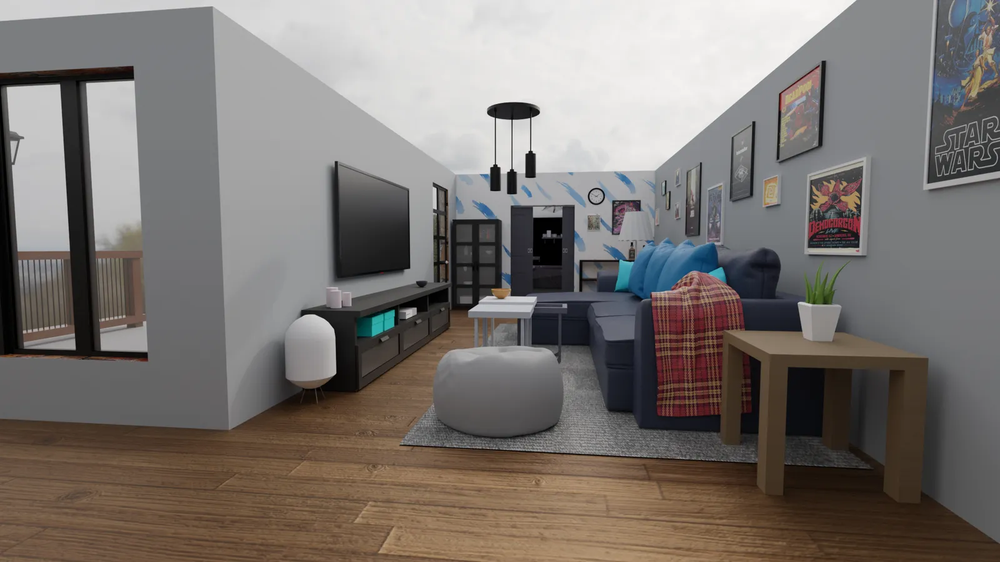
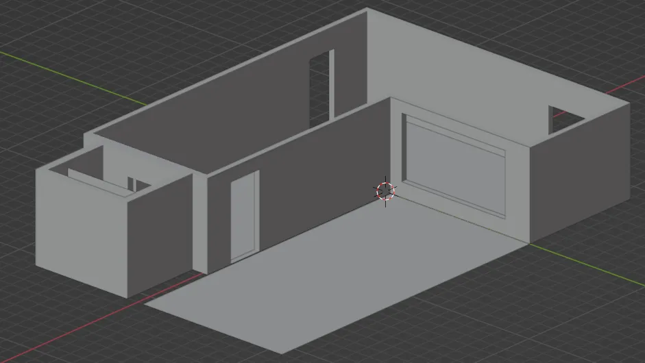
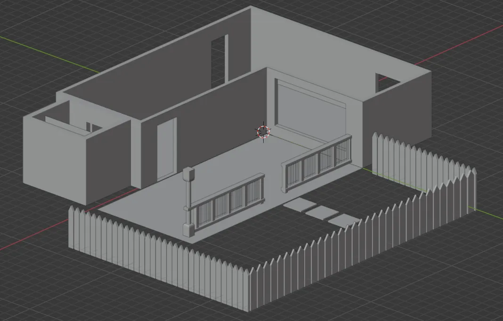
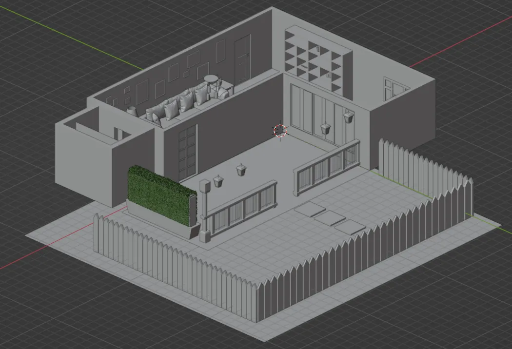
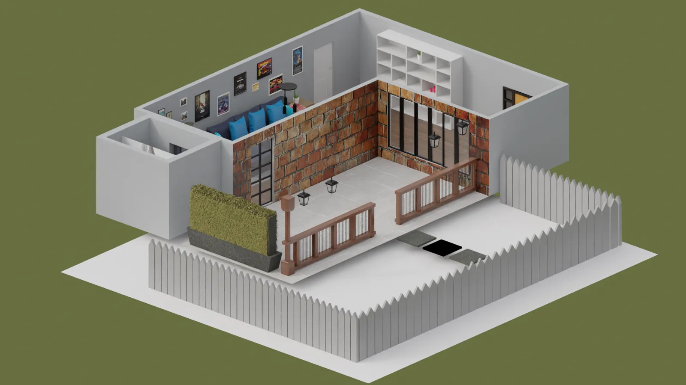

# Ambiente virtuale — Sistemi di Realtà Virtuale

Progetto d'esame per il corso di **Sistemi di Realtà Virtuale** (2023).
Un soggiorno ricostruito in 3D a partire da una foto di riferimento, modellato in **Blender** e reso esplorabile in prima persona in **Unreal Engine 5**.

## Il progetto

Il progetto è diviso in due parti:

1. **Modellazione** — ricreare in 3D l'ambiente di una foto di riferimento.
2. **Interazione** — rendere la scena esplorabile e interattiva.

Per rendere l'esplorazione più ampia, l'immagine di partenza è stata estesa con l'intelligenza artificiale, aggiungendo una stanza secondaria sullo sfondo.

## Modellazione in Blender

- **Struttura della stanza** realizzata per prima, per definire spazio e proporzioni degli oggetti.
- **Mobile, TV e oggetti decorativi**, con materiali costruiti nello Shader Editor: legno, vetro e schermo.
- **Divano** con un unico materiale riutilizzato, cambiando solo il colore di base.
- **Coperta** simulata con il modificatore *Cloth*, lasciata cadere sul cuscino fino a prendere la forma naturale.
- **Texture** create con **Materialize** a partire da immagini, per ottenere mappe di colore, normali e rugosità.
- **Stanza secondaria** con tagli in corrispondenza di scaffali e oggetti, per simulare profondità durante l'esplorazione in prima persona.
- Esportazione in **FBX** con le trasformazioni applicate, e importazione in Unreal Engine 5.

### Dalla struttura alla scena completa

| 1. Struttura | 2. Esterno | 3. Arredamento |
|---|---|---|
|  |  |  |

## Interazione in Unreal Engine 5

Tutta la logica è realizzata con i **Blueprint**:

- **Movimento in prima persona** — una capsula delle dimensioni del giocatore, con la camera all'altezza degli occhi.
- **Menu principale** all'avvio, con i pulsanti *Gioca* ed *Esci*.
- **Menu di pausa** con il tasto `Esc`, per riprendere o chiudere il gioco.
- **Interazioni a distanza ravvicinata** — ogni interazione funziona solo quando il giocatore si trova dentro un *box collision* vicino all'oggetto.
- **Luci accese e spente** con il tasto azione.
- **Audio spaziale** — il volume cambia in base alla distanza dalla sorgente, e la riproduzione continua anche quando ci si allontana.
- **Audio acceso e spento** con il tasto azione.
- **Giorno e notte** — un blueprint ruota la luce direzionale per vedere la stanza nei due momenti.

## Render

| Interno | Esterno |
|---|---|
|  |  |

## Contenuto del repository

| File | Contenuto |
|---|---|
| `presentazione.pdf` | la presentazione d'esame completa, con shader, blueprint e render |
| `images/` | fasi della modellazione e render della scena finale |
| **Releases** | il progetto scaricabile: file Blender, texture e progetto Unreal Engine 5 |

## Strumenti

Blender · Unreal Engine 5 · Blueprint · Materialize

---

Realizzato da **Marco Capasso**.
